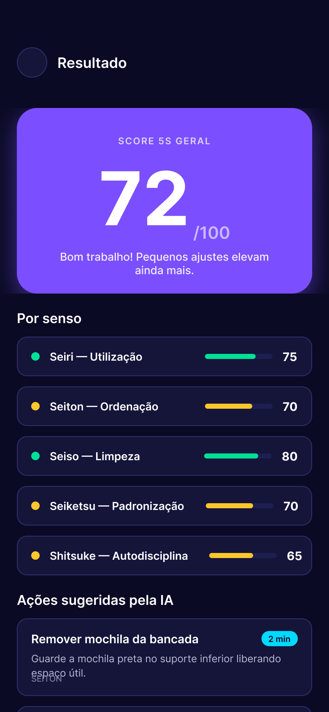
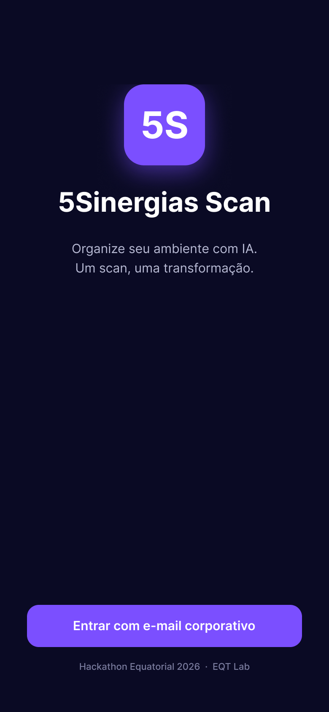
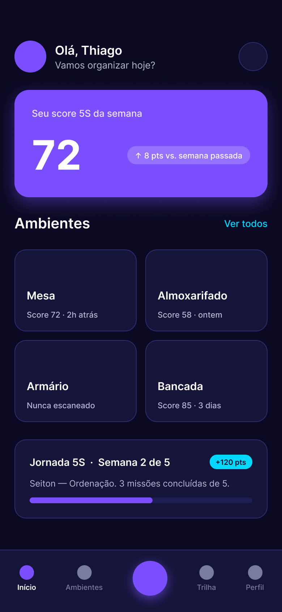
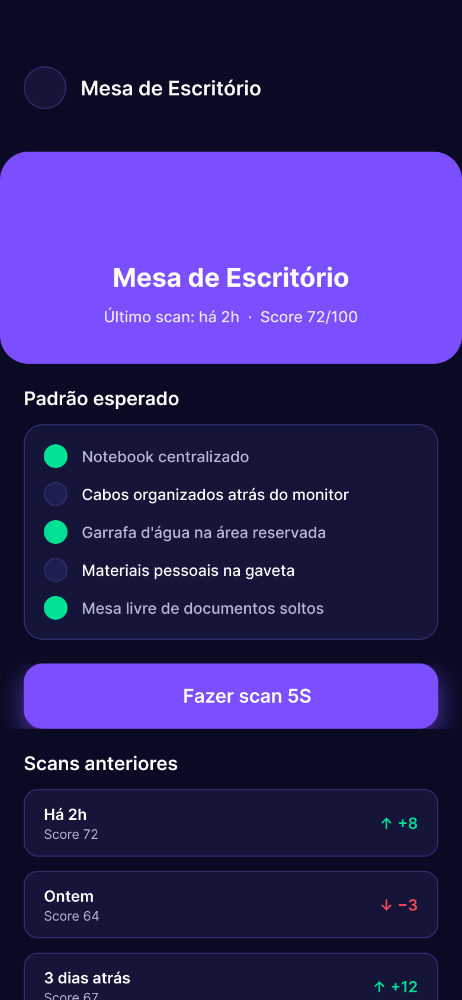
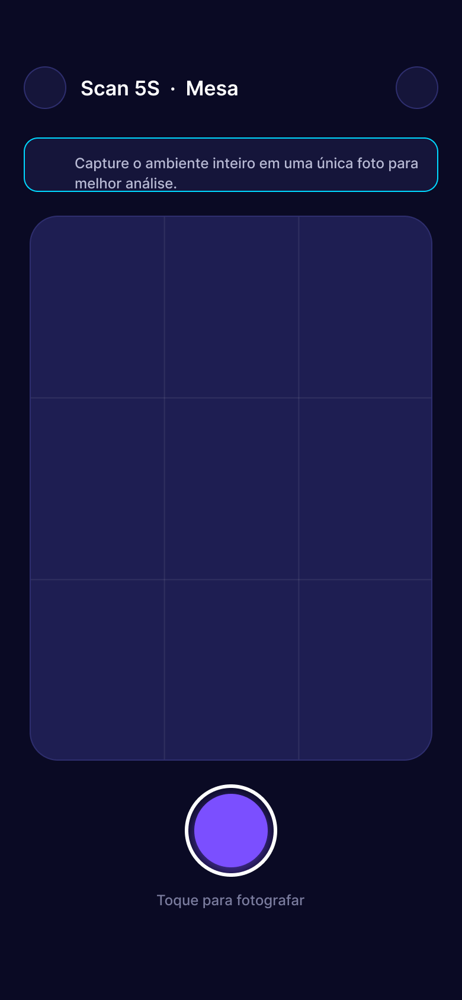
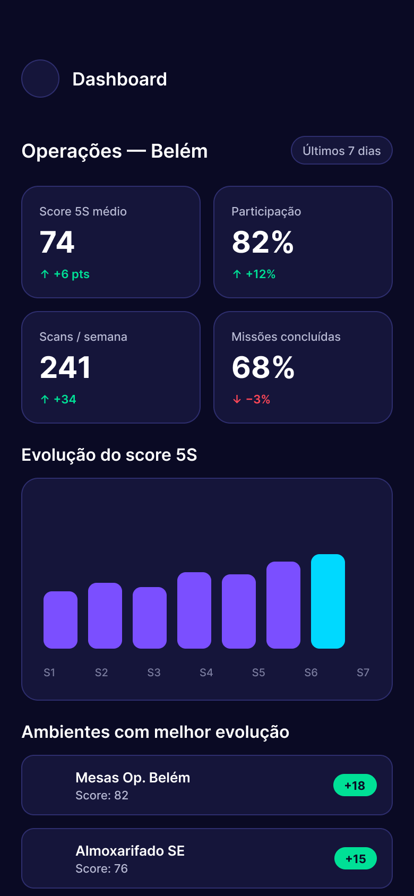

<div align="center">

# 5Sinergias Scan

### Organize seu ambiente com IA. Um scan, uma transformação.

Diagnóstico 5S instantâneo a partir de uma foto — avaliação por senso, itens detectados e ações práticas em menos de 10 segundos.

[](https://eqtlab.com.br)
[](https://eqtlab.com.br)
[]()

[**🎨 Figma clicável**](https://www.figma.com/design/E8WUQ3FR3GWlLqc8vc67Nn) · [**📸 Protótipo em Present mode**](https://www.figma.com/proto/E8WUQ3FR3GWlLqc8vc67Nn) · [**💻 Repositório**](https://github.com/AkiraGitDev/5sinergias-scan)



</div>

---

## 💡 O problema

A metodologia **5S** (Seiri, Seiton, Seiso, Seiketsu, Shitsuke) é central para segurança, bem-estar e eficiência no Grupo Equatorial Energia — mas a auditoria é **100% manual** e difícil de escalar entre milhares de colaboradores distribuídos entre escritório, campo e almoxarifados.

**Desafio 10 do Hackathon Equatorial / EQT Lab:** criar um MVP digital, engajador e educacional, baseado na metodologia 5S, que envolva colaboradores na organização e transformação dos ambientes.

## ✨ A solução

**5Sinergias Scan** combina **visão computacional** com **gamificação em jornada 5S** para transformar auditoria em um gesto de 10 segundos.

O colaborador aponta a câmera para o ambiente (mesa, almoxarifado, armário, bancada) e recebe:

- **Score 5S** por senso (0–100), com observações específicas de cada um
- **Itens detectados** fora do padrão, citando objetos reais da foto
- **3–5 ações sugeridas pela IA**, cada uma executável em menos de 5 min
- **Resumo motivacional** e badges da trilha gamificada

## 🧠 Como funciona

```
┌──────────────┐    ┌──────────────┐    ┌──────────────┐    ┌──────────────┐
│  Colaborador │ ─> │  Foto do     │ ─> │  IA Gemini   │ ─> │  Diagnóstico │
│  aponta app  │    │  ambiente    │    │  3.5 Vision  │    │  5S completo │
└──────────────┘    └──────────────┘    └──────────────┘    └──────────────┘
                                               │
                                               └─> Score por senso
                                                   Itens detectados
                                                   Ações sugeridas
                                                   Badge gamificada
```

A chamada ao modelo é feita no servidor (API route Next.js) com **fallback automático em 5 modelos** da família Gemini para zero downtime em dias de alta demanda.

## 📱 Screenshots

<table>
  <tr>
    <td align="center" width="33%">
      <br />
      <sub><b>01 — Splash</b></sub><br />
      <sub>Entrada EQT Lab</sub>
    </td>
    <td align="center" width="33%">
      <br />
      <sub><b>02 — Home</b></sub><br />
      <sub>Score semanal + ambientes</sub>
    </td>
    <td align="center" width="33%">
      <br />
      <sub><b>04 — Card do Ambiente</b></sub><br />
      <sub>Padrão esperado + histórico</sub>
    </td>
  </tr>
  <tr>
    <td align="center" width="33%">
      <br />
      <sub><b>05 — Scan 5S ★</b></sub><br />
      <sub>Câmera com grid guia</sub>
    </td>
    <td align="center" width="33%">
      <br />
      <sub><b>06 — Resultado 5S ★</b></sub><br />
      <sub>Score + ações IA</sub>
    </td>
    <td align="center" width="33%">
      <br />
      <sub><b>08 — Dashboard</b></sub><br />
      <sub>Visão da liderança</sub>
    </td>
  </tr>
</table>

> ★ Telas plugadas ao código real. As demais vivem no Figma clicável como roadmap do produto.

## 🛠️ Stack

| Camada | Tecnologia |
|---|---|
| **Frontend** | Next.js 16 (App Router) · React 19 · TypeScript · Tailwind 4 · Lucide React |
| **IA** | Gemini 3.5 Flash Lite (com fallback para 3.1 / latest / 3.6 / 3.5) |
| **Design** | Figma (protótipo com 8 telas e 16 reactions) |
| **Deploy** | Vercel |
| **Fonte** | Inter |

### Paleta EQT Lab

```
#0A0A24  bg-primary        #7B4FFF  primary
#15153A  bg-surface        #00D9FF  accent-cyan
#1E1E52  bg-elevated       #00E096  success
#2E2E6E  border-subtle     #FFC72C  warning
#B8BAD4  text-secondary    #FF4757  danger
```

## 🚀 Rodando local

### Pré-requisitos
- Node.js 20+
- Chave da Gemini API (grátis em [aistudio.google.com/apikey](https://aistudio.google.com/apikey))

### Setup
```bash
git clone https://github.com/AkiraGitDev/5sinergias-scan.git
cd 5sinergias-scan
npm install
echo "GEMINI_API_KEY=sua_chave_aqui" > .env.local
npm run dev
```

Abra http://localhost:3000 no celular (via mesma rede) ou no desktop e selecione um ambiente para começar.

## 📂 Estrutura

```
5sinergias-scan/
├── src/
│   ├── app/
│   │   ├── layout.tsx          # Inter + metadata + viewport mobile
│   │   ├── globals.css         # Tokens de cor EQT Lab via @theme
│   │   ├── page.tsx            # Client flow: idle → preview → analyzing → result
│   │   └── api/scan/route.ts   # POST /api/scan (FormData → Gemini → JSON)
│   └── lib/
│       ├── types.ts            # AMBIENTES, Senso, ScanResult shape
│       └── gemini.ts           # Vision call com retry + fallback de modelos
├── docs/screens/               # Screenshots do Figma (este README)
└── .env.local                  # GEMINI_API_KEY (gitignored)
```

## 🎯 O que foi priorizado no MVP

**Dentro de escopo:**
- ✅ Captura de foto (câmera do dispositivo) + preview + análise
- ✅ Diagnóstico 5S completo com IA, retornando JSON estruturado
- ✅ UI mobile-first em pt-BR
- ✅ Fallback automático de modelo para zero downtime

**Fora de escopo (vive no Figma como roadmap):**
- 🔮 Autenticação corporativa (SSO Azure AD)
- 🔮 QR Code físico por ambiente para contextualização automática
- 🔮 Trilha gamificada completa (jornada de 5 semanas, 1 senso/semana)
- 🔮 Dashboard de liderança com métricas agregadas
- 🔮 Integração com Viva Engage / Fique por Dentro / TVs corporativas
- 🔮 Comparação antes/depois com geração de imagem ideal

## 🧪 Como funciona o diagnóstico

O endpoint `/api/scan` recebe `multipart/form-data` com:
- `photo` — JPEG, PNG ou WebP até 10 MB
- `ambiente` — `mesa` | `almoxarifado` | `armario` | `bancada`

Envia para o Gemini com um **system prompt** calibrado para o contexto Equatorial e um **response schema JSON** garantindo estrutura previsível na saída:

```ts
{
  scoreGeral: number,          // 0-100
  sensos: {
    seiri: { score, observacao },
    seiton: { score, observacao },
    seiso: { score, observacao },
    seiketsu: { score, observacao },
    shitsuke: { score, observacao },
  },
  itensDetectados: [{ objeto, problema, senso }],
  acoesSugeridas: [{ titulo, descricao, tempoEstimadoMin, senso }],
  resumoMotivacional: string,
}
```

## 🤝 Hackathon Equatorial 2026 · EQT Lab

Projeto desenvolvido para o **Desafio 10 — 5Sinergias** do Hackathon Equatorial 2026, promovido pelo [EQT Lab](https://eqtlab.com.br).

> *"Criar uma solução baseada na metodologia 5S que envolva os colaboradores na organização e transformação dos ambientes, promovendo bem-estar, colaboração e melhoria contínua de forma simples e sustentável."*

**Pontos valorizados que o MVP endereça:** gamificação (jornada + badges), UX de fricção zero (um gesto, sem instalar app), IA com propósito real (visão computacional explica o que viu), dashboard para liderança, hooks para integração com Viva Engage e TVs corporativas.

---

<div align="center">

Feito em 4 dias · Outubro de 2026

</div>
